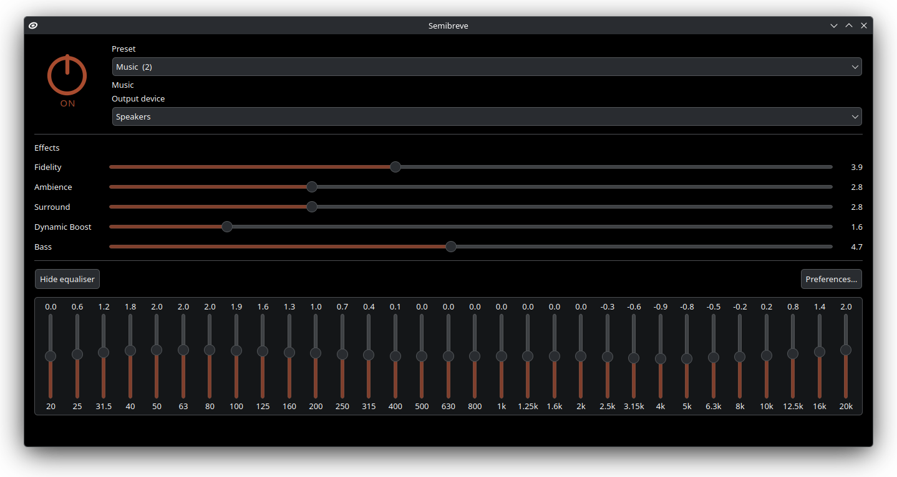

# Semibreve

An equaliser for Linux: FxSound's audio processing, running as a PipeWire filter with a native UI.



Semibreve adds an output device called **Semibreve** to PipeWire. Everything
played through it passes through FxSound's audio engine (the same effects,
presets and tuning as FxSound on Windows) and then on to your speakers or
headphones. I built it because FxSound only runs on Windows, and its DSP is
twenty-odd years of tuning decisions I wanted to keep rather than imitate.

So the DSP is not a reimplementation. It is FxSound's own C source, built for
Linux with GCC. The changes Linux needed are kept to the edges: shims live in
`dsp/linux/`, and every edit to FxSound's files is marked with a `Semibreve:`
comment explaining it.

## Features

- FxSound's five effects: Fidelity, Ambience, Surround, Dynamic Boost and Bass
- A 31-band graphic equaliser
- FxSound's 31 stock presets
- A choice of output device, so the processed sound can go to any speaker,
  headphone or DAC
- A power button and a tray icon showing whether processing is on
- One command starts everything and routes your audio through it, and quitting
  puts your audio back where it was
- Settings are remembered between launches

## Status

Working on Fedora 44 with PipeWire. Missing: packages and a systemd user unit,
so for now it starts with `./bin/semibreve` rather than with your session.

## Built with

C and C++ for FxSound's DSP and the audio daemon, built with GCC; PipeWire for
the audio graph; sd-bus from libsystemd for the D-Bus control interface; and
Python with PySide6 and dbus-python for the window. It runs on Fedora Linux
with PipeWire. KDE Plasma is recommended: on GNOME there is no tray area by
default and the window blur is unavailable; everything else works.

Three pieces, split so that nothing in the window can ever stall the audio:

| Piece | What it is |
|---|---|
| `libdfxdsp.so` | FxSound's DSP (`dsp/`, plus the utility sources in `vendor/audiopassthru/`) |
| `semibreved` | A PipeWire node: it registers the Semibreve sink, runs the DSP in the audio callback, and exposes its controls on the session bus as `org.semibreve.Daemon` |
| `semibreve` | The PySide6 window and tray icon, which talk to the daemon over D-Bus |

Semibreve is built on [FxSound](https://github.com/fxsound2/fxsound-app),
copyright FxSound LLC, under AGPL-3.0, and is AGPL-3.0 too; see
[LICENSE](LICENSE). FxSound's copyright notices are kept in the files it
wrote, and the stock presets are FxSound's.

## Build and run

Install the compiler, the PipeWire and systemd headers, Qt for Python, and the
audio command-line tools, then build:

```bash
sudo dnf install gcc gcc-c++ pkgconf-pkg-config pipewire-devel systemd-devel \
    python3 python3-pyside6 python3-dbus python3-tomli-w python3-platformdirs \
    pulseaudio-utils pipewire-utils diffutils

git clone https://github.com/jacksonvw/semibreve.git
cd semibreve
./build.sh
./bin/semibreve
```

`build.sh` produces `build/libdfxdsp.so` (the DSP) and `build/semibreved` (the
audio daemon); the window is Python and needs no build step. `./bin/semibreve`
starts the audio engine and the window, makes Semibreve your default output,
and moves anything that is already playing onto it.

- Closing the window hides it to the tray; the sound keeps being processed.
- **Quit** in the tray menu, or `./bin/semibreve --stop`, stops Semibreve and
  puts your audio back on the device it was using before.
- `./bin/semibreve --no-route` starts it without changing your default output.
- Logs go to `/tmp/semibreve.log` (window) and `/tmp/semibreved.log` (engine).

To add it to the app menu, run these from the `semibreve` folder. They link the
launcher into your personal commands folder, install the menu entry pointing at
it, and install the icon:

```bash
mkdir -p ~/.local/bin ~/.local/share/applications ~/.local/share/icons/hicolor/scalable/apps
ln -sf "$PWD/bin/semibreve" ~/.local/bin/semibreve
sed "s|^Exec=.*|Exec=$HOME/.local/bin/semibreve|" semibreve.desktop \
    > ~/.local/share/applications/semibreve.desktop
cp semibreve/resources/semibreve.svg ~/.local/share/icons/hicolor/scalable/apps/
```

To update, `git pull` and run `./build.sh` again.

The daemon can also be driven without the window:

```bash
./build/semibreved --list-presets
./build/semibreved --preset Jazz
busctl --user introspect org.semibreve.Daemon /org/semibreve/Daemon
busctl --user set-property org.semibreve.Daemon /org/semibreve/Daemon \
    org.semibreve.Daemon Fidelity d 7.5
```

The checks need no audio hardware. They confirm that bypass passes audio
through bit-for-bit, that all 31 presets load and process, that the output does
not depend on the buffer size, and that the output is identical at every GCC
optimisation level:

```bash
./run_checks.sh          # about a minute and a half
./run_checks.sh quick    # skips the optimisation-level comparison
```

Three more checks run against your live PipeWire session, without making any
sound: `tools/live_check.sh` (the audio path), `tools/dbus_check.sh` (the
control interface, including a preset change while audio plays) and
`tools/ui_check.sh` (the window, run offscreen).

---

Jackson Vander Wal · [jacksonv.com](https://jacksonv.com)
